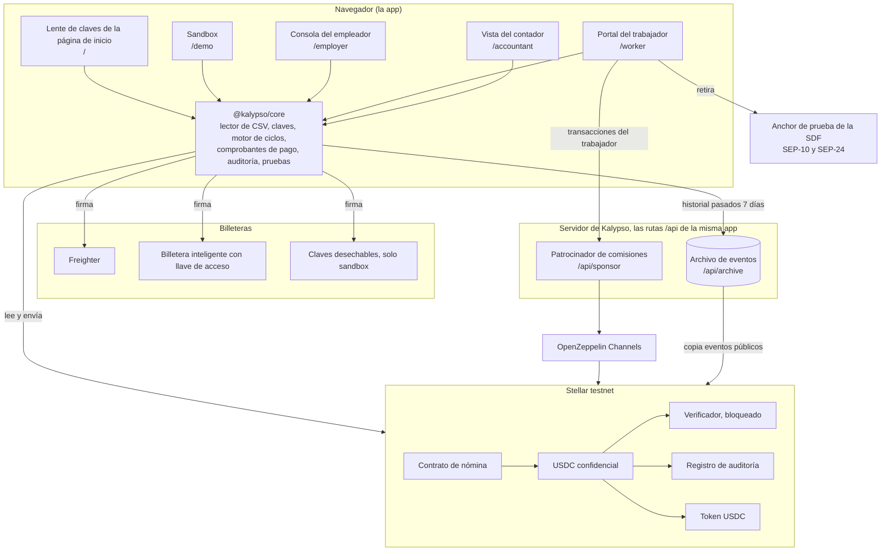
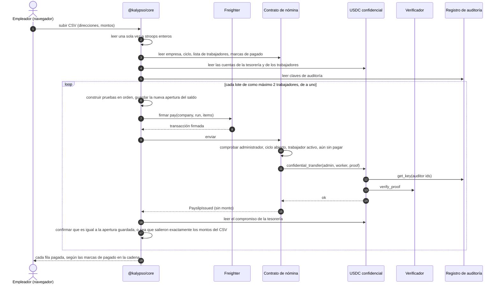
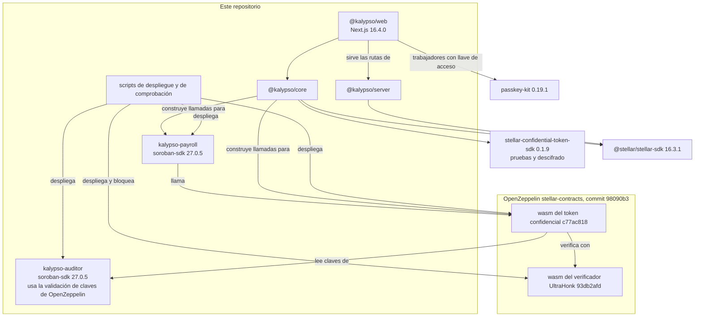

Kalypso tiene cuatro partes: el token confidencial de OpenZeppelin en Stellar, dos contratos propios (nómina y un registro de claves de auditoría), una biblioteca cliente que la app web ejecuta en el navegador, y un servidor con un patrocinador de comisiones y un archivo de eventos, servido por la misma app.

## El sistema completo

Los montos existen en forma legible solo en el navegador del empleador (el CSV que sube), en el del trabajador (sus propios comprobantes de pago) y en el del contador (con su clave). El servidor ve los bytes de las transacciones, donde los montos son textos cifrados, y los eventos públicos.

Cada caja del navegador es una página de la app. La lente de claves de la página de inicio (`/`) lee la empresa de muestra con la clave que elijas, y el sandbox (`/demo`) ejecuta una nómina completa con claves desechables. La consola del empleador (`/employer`) y la vista del contador (`/accountant`) firman con Freighter. El portal del trabajador (`/worker`) firma con una billetera inteligente con llave de acceso o con Freighter, envía las llamadas al contrato del trabajador a través del patrocinador de comisiones y retira en el anchor de prueba de la SDF. Las [guías](/docs/guides/employer) recorren cada pantalla.

## El token confidencial

Kalypso no inventa su propia criptografía. El dinero se mueve con el token confidencial de OpenZeppelin para Stellar (la revisión del 31 de julio de 2026, commit 98090b3 de OpenZeppelin/stellar-contracts), desplegado como una instancia propia de Kalypso sobre el USDC de testnet de Circle.

- Depositas USDC en el token y obtienes un saldo confidencial. Los montos de depósito son públicos.
- Los saldos y los montos de las transferencias se guardan como compromisos de Pedersen: números sellados que el contrato puede sumar y comprobar, pero no leer. El titular guarda fuera de la cadena la apertura de cada compromiso: el valor y el factor aleatorio de cegado.
- Cada gasto lleva una prueba de conocimiento cero construida por quien envía. Demuestra que el pago es válido y que quien envía puede costearlo, sin mostrar el número. Un contrato verificador aparte comprueba cada prueba.
- Cada cuenta se registra una sola vez con un id de auditor, sin forma de cambiarlo después. Cada transferencia la pueden leer dos claves de auditor: la de quien envía, que ve el monto y el nuevo saldo de quien envía, y la de quien recibe, que ve el monto.
- El dinero entrante llega a un saldo de recepción aparte y se fusiona antes de gastarse, así que nadie puede romper una prueba de gasto enviándote dinero.
- Las direcciones de quien envía y de quien recibe son públicas. Los montos de retiro son públicos.

## Qué agrega el contrato de nómina

El token puede mover dinero confidencial, pero no sabe nada de empresas, listas de trabajadores ni períodos de pago. El [contrato de nómina](https://github.com/ramakrishnanhulk20/Kalypso/blob/main/packages/contracts/payroll/src/contract.rs) los agrega, y mueve dinero solo llamando al `confidential_transfer` del token desde la tesorería de la empresa.

- Empresas. `create_company(admin, accountant, auditor_id, label)` crea una empresa cuya tesorería es la cuenta del administrador. El administrador ya debe estar registrado en el token con `auditor_id`, y el registro de auditoría debe decir que `accountant` es dueño de ese id, o la llamada falla con el error 23.
- Invitaciones. El administrador invita a un trabajador y el trabajador acepta con su propia firma. Un trabajador ya debe estar registrado en el token para aceptar. El administrador puede retirar una invitación sin aceptar o quitar a un trabajador, y el historial de pagos se queda.
- Ciclos. `open_run` abre un período de pago con una cantidad esperada de trabajadores. El id de un ciclo se abre una sola vez por empresa, para siempre, y `close_run` lo termina.
- Pagar como máximo una vez. `pay(company_id, run_id, items)` recibe uno o dos trabajadores, cada uno con una prueba. Comprueba la firma del administrador, que el ciclo esté abierto y que cada trabajador esté en la lista y aún no haya cobrado en este ciclo. Luego llama a la transferencia del token por cada trabajador y marca a cada uno como pagado. Un trabajador listado dos veces revierte toda la llamada. El evento del comprobante de pago no lleva monto. El tope de dos se fijó a partir de tamaños de transacción medidos.
- Contadores. Cada empresa cuenta los ciclos que abrió y los cambios de administrador, y `memberships_of(worker)` cuenta las empresas a las que un trabajador se unió alguna vez. Un lector de historial al que le entregan menos ciclos o empresas de los que cuenta la cadena sabe que algo se ocultó.
- Traspaso. El rol de administrador se mueve en dos pasos. La oferta vence dentro de la vida de almacenamiento más larga de la red, y el administrador entrante debe estar registrado con el id de auditor de la empresa.

Las listas de trabajadores, los ciclos y las marcas de pagado viven en almacenamiento persistente, y cada escritura los extiende a 180 días. El contrato no tiene administrador propio ni vía de actualización. Su token y su registro los fija el constructor para toda la vida del contrato.

## El registro de auditoría

El contrato de auditor de ejemplo de OpenZeppelin deja que un solo gestor fije la clave bajo cada id de auditor. Quien tuviera ese rol podría cambiar la clave de un contador por la suya y leer todos los sueldos futuros. El [registro de auditoría](https://github.com/ramakrishnanhulk20/Kalypso/blob/main/packages/contracts/auditor/src/contract.rs) de Kalypso no tiene gestor ni administrador.

- `register_key(owner, point)` guarda una clave y devuelve el siguiente id. Firma el dueño, normalmente el contador.
- Solo el dueño puede hacer `rotate_key`. La propiedad se mueve en dos pasos, con una oferta que vence.
- Las claves pasan por la validación de claves de OpenZeppelin, que rechaza el punto identidad y los puntos fuera de la curva.

Los ids se entregan en orden, así que cualquiera puede leer el siguiente id y registrar primero su propia clave en él. Una tesorería que se registrara bajo un id predicho cifraría cada sueldo para el atacante. Kalypso nunca predice un id. La tesorería se registra bajo el id que devolvió el registro confirmado del contador. Antes de que la tesorería firme, el cliente lee de la cadena el dueño y la clave de ese id, y se niega a seguir a menos que sean los del contador. Y el contrato de nómina se niega a crear una empresa a menos que el registro diga que el contador nombrado es dueño del id. El ataque P11 del [informe del ataque](/docs/security/attack-run) intenta este front-run contra testnet en cada ejecución.

Los trabajadores también registran su propia clave de auditoría, así que la copia de cada pago para quien recibe se abre solo para ese trabajador.

## Qué ocurre en el navegador

La biblioteca cliente, `@kalypso/core`, hace cada paso que necesita un secreto, así que los secretos se quedan en el dispositivo.

### Claves

La clave de un usuario de Freighter sale de que la billetera firme un mensaje que nombra a Kalypso, su dominio, la red, el token y la cuenta, y que dice que se firme solo en el dominio de Kalypso. La derivación toma dos firmas sobre ese mensaje y se niega a seguir a menos que sean idénticas byte por byte, así que se demuestra que una clave es reproducible antes de registrar nada con ella. Los usuarios de llave de acceso derivan la clave de la salida PRF de la llave de acceso, y una llave de acceso que no devuelve salida PRF se rechaza, nunca se debilita. Esa misma salida PRF también crea la clave de la cuenta de retiro del trabajador. Ambos caminos están fijados con vectores de prueba. El portal del trabajador ofrece los dos, y la consola del empleador y la vista del contador usan Freighter. El camino de la llave de acceso se ha ejecutado de punta a punta en Chrome con un autenticador virtual que admite PRF. El soporte de PRF cambia entre teléfonos, laptops y proveedores de llaves de acceso, y Kalypso no se ha comprobado en todos.

### Pruebas

Cada prueba se construye en el navegador con los circuitos publicados del token, usando una sal nueva de `crypto.getRandomValues`. Un reintento después de una reversión construye una prueba nueva con una sal nueva.

### El motor de ciclos

Un ciclo de pago, de punta a punta:

- La planilla se lee una sola vez a stroops enteros, la unidad más pequeña del USDC (7 decimales). Lo que el empleador aprueba, la entrada de la prueba y la comprobación posterior al pago usan ese único valor leído.
- Antes de cualquier transacción, una verificación previa revisa la empresa, el ciclo, la entrada de cada trabajador en la lista y su registro en el token, que nadie esté atado a la clave de auditor de demostración publicada, y que el saldo verificado de la tesorería cubra el ciclo.
- Cada transacción de pago lleva hasta dos pagos, y solo hay un pago por tesorería en curso a la vez. Cada lote se prueba solo contra el estado de la cadena posterior a que el lote anterior sea final.
- Después de que cada pago se confirma, el motor lee el nuevo compromiso de la tesorería y confirma que se abre con el saldo guardado antes de enviar, o sea que salieron exactamente los montos aprobados. Cualquier diferencia detiene el ciclo.
- Las etiquetas pagado, pendiente y fallido salen de las marcas de pagado del contrato, nunca de la respuesta de un relayer. Un lote que no se puede construir, por ejemplo después de que un trabajador rotó su clave, marca como fallidas solo sus propias filas y el ciclo sigue. Un rechazo de la red detiene el ciclo.

### Nunca olvidar un pago confirmado

Antes de enviar un pago, el dispositivo guarda la nueva apertura del saldo que ese pago dejará. Ese registro se borra solo después de adoptar una apertura que abre la cadena, o después de que la transacción falló o venció según el propio reloj de la cadena. Ninguna respuesta de RPC borra una apertura guardada. Un saldo leído un ledger atrasado, una hora de cierre mentirosa o una segunda pestaña terminan entonces con el ciclo retomándose, nunca con una tesorería bloqueada. Un ciclo que se cae a la mitad se retoma desde las marcas de pagado en la cadena, y nadie cobra dos veces.

### La reconstrucción

En una laptop nueva, tras borrar el almacenamiento, o cuando los registros del dispositivo no coinciden con la cadena, el empleador puede reconstruir la apertura de la tesorería a partir de su historial en el token. El resultado debe abrir el saldo en la cadena o no se escribe nada. Lo que el dispositivo esperaba se muestra junto a lo que tiene la cadena, porque una diferencia significa que la tesorería se movió de una forma que este dispositivo no registró. La reconstrucción es siempre un paso explícito, nunca automático.

### Leer el pago

Un comprobante de pago se muestra solo cuando coinciden un evento de nómina del contrato de Kalypso, una transferencia del token desde la tesorería de la empresa hacia ese trabajador en la misma transacción y la marca de pagado en la cadena, y el monto descifrado está dentro de rango. Una transferencia directa o un depósito de cualquier otra persona nunca se convierte en un comprobante de pago, y los totales del contador cuentan exactamente el mismo conjunto. Cada saldo reconstruido a partir del historial se comprueba contra el compromiso en la cadena antes de mostrarse o usarse, y una diferencia muestra "historial incompleto", nunca un número.

## El patrocinador de comisiones y el archivo

El patrocinador de comisiones (`POST /api/sponsor`) paga la comisión de red de las transacciones propias de un trabajador y las retransmite a través de OpenZeppelin Channels. Para un trabajador con llave de acceso, lleva todo el proceso de unirse: crear la billetera con llave de acceso, registrar la clave de auditoría propia del trabajador, registrarse en el token y aceptar la invitación. También paga la fusión y el retiro que mueven el pago a la cuenta de retiro. Un trabajador con Freighter firma su propia transacción, y el patrocinador la envuelve en un fee bump. La consola del empleador y la vista del contador no lo usan: esas billeteras pagan sus propias comisiones.

No es un relay abierto. Decodifica los bytes exactos que va a reenviar y paga solo por una función del host cuya raíz sea una de tres cosas: una llamada al contrato de nómina o al token de Kalypso, `register_key` en el registro de auditoría de Kalypso firmada solo por el dueño de la clave, o la creación de una billetera con llave de acceso. Esa creación debe venir del desplegador compartido de passkey-kit, ejecutar el código de billetera fijado y fijar exactamente un firmante de llave de acceso sin vencimiento y sin límites, y solo puede tocar las entradas de su propia billetera nueva. Cada contrato que la llamada pueda ejecutar debe ser de Kalypso, del USDC, el verificador, o una billetera que ejecute el código fijado, y la comisión debe ser menor que 2.5 XLM en testnet. Los límites se aplican por IP por hora, por dirección que autoriza por día, a un máximo de tres creaciones de billetera por IP por día, y a un presupuesto diario de 200 XLM en testnet. Un relay que el relayer rechazó de forma demostrable devuelve su presupuesto, y una aprobación firmada se retransmite como máximo una vez. El patrocinador nunca paga por operaciones simples de Stellar, así que una cuenta de retiro paga ella misma sus pequeñas comisiones en XLM por su línea de confianza de USDC y el pago al anchor.

Stellar RPC conserva cerca de los últimos 7 días de eventos, y un saldo confidencial no se puede leer ni gastar sin su historial. El archivo de eventos copia textualmente los eventos públicos de los contratos de Kalypso, con una programación que no depende de las visitas, y los deduplica por id de evento. Lleva la cuenta de qué ledgers tiene, sin huecos. Cada respuesta dice si está completa y hasta dónde ha ingerido, y su chequeo de salud responde 503 ante un hueco o una ingesta atrasada. Da fe del historial desde el despliegue solo cuando los primeros eventos del token que leyó vienen de la propia transacción de despliegue del token; si no, su chequeo de salud dice desde qué ledger da fe. Su API vive en `/api/archive/v1/...` en el propio servidor de la app y es compatible con los clientes de indexador del SDK confidencial.

Cada pantalla lee el archivo desde su propio sitio en `/api/archive`, y solo por https. Cuando el archivo no responde, o la página corre en un servidor de desarrollo http simple, los lectores usan solo la ventana de RPC, así que el historial de más de unos 7 días se muestra como incompleto en vez de como un número.

Nada confía solo en el archivo. Un saldo reconstruido a partir de él debe abrir el compromiso en la cadena, y una lista de comprobantes de pago debe coincidir con los contadores de la propia cadena. Está en vivo, y su estado es público en https://kalypso-payroll.vercel.app/api/archive/v1/health.

## De qué depende cada cosa

Los dos contratos fijan soroban-sdk 27.0.5 para coincidir con el token de OpenZeppelin desplegado. Cada dirección, hash de código y llamada está en [Contratos y direcciones](/docs/contracts).
