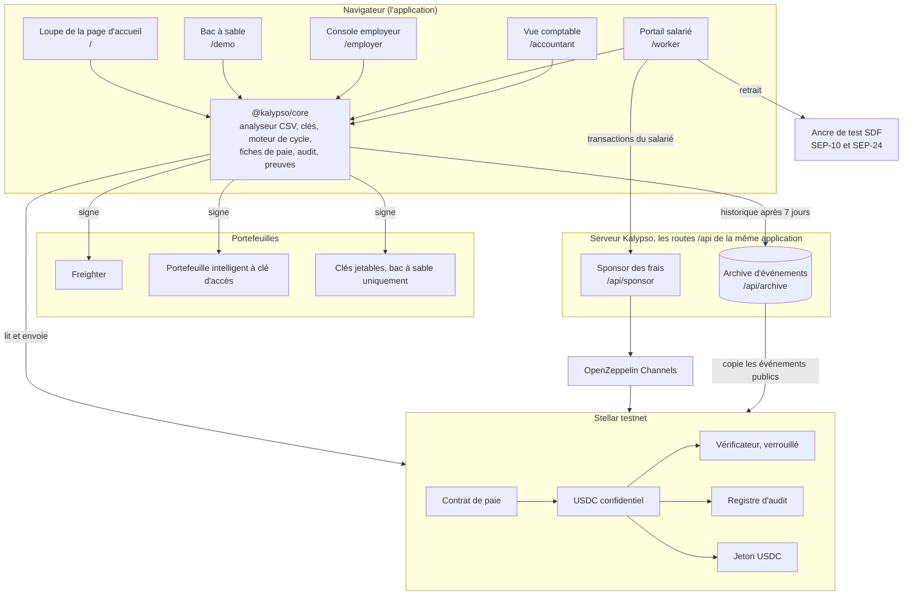
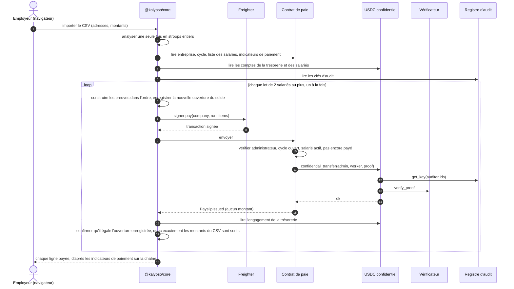
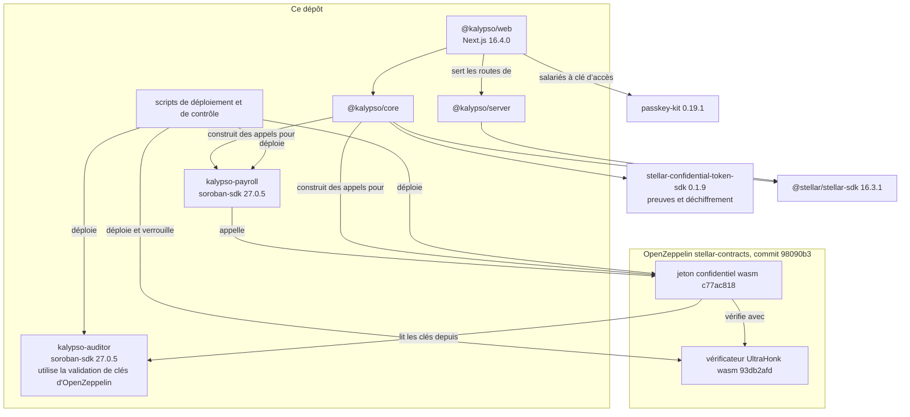

Kalypso a quatre parties : le jeton confidentiel d'OpenZeppelin sur Stellar, deux contrats à nous (la paie et un registre de clés d'audit), une bibliothèque cliente que l'application web exécute dans le navigateur, et un serveur avec un sponsor des frais et une archive d'événements, servi par la même application.

## Le système entier

Les montants n'existent en clair que dans le navigateur de l'employeur (le CSV qu'il importe), dans celui du salarié (ses propres fiches de paie) et dans celui du comptable (avec sa clé). Le serveur voit les octets des transactions, où les montants sont des textes chiffrés, et les événements publics.

Chaque boîte du navigateur est une page de l'application. La loupe de la page d'accueil (`/`) lit l'entreprise de démonstration avec la clé que vous choisissez, et le bac à sable (`/demo`) exécute toute une paie avec des clés jetables. La console employeur (`/employer`) et la vue comptable (`/accountant`) signent avec Freighter. Le portail salarié (`/worker`) signe avec un portefeuille intelligent à clé d'accès ou avec Freighter, envoie les appels de contrat du salarié par le sponsor des frais, et retire l'argent auprès de l'ancre de test de la SDF. Les [guides](/docs/guides/employer) détaillent chaque écran.

## Le jeton confidentiel

Kalypso n'invente pas sa propre cryptographie. L'argent circule par le jeton confidentiel d'OpenZeppelin pour Stellar (la révision du 31 juillet 2026, commit 98090b3 de OpenZeppelin/stellar-contracts), déployé comme instance propre à Kalypso au-dessus de l'USDC testnet de Circle.

- Vous déposez des USDC dans le jeton et obtenez un solde confidentiel. Les montants de dépôt sont publics.
- Les soldes et les montants de transfert sont stockés sous forme d'engagements de Pedersen : des nombres scellés que le contrat peut additionner et contrôler, mais pas lire. Le titulaire garde, hors chaîne, l'ouverture, la valeur et l'aléa de masquage derrière chaque engagement.
- Chaque dépense porte une preuve à divulgation nulle de connaissance construite par l'expéditeur. Elle montre que le paiement est valide et que l'expéditeur peut le couvrir, sans montrer le chiffre. Un contrat vérificateur distinct contrôle chaque preuve.
- Chaque compte s'enregistre sous un seul identifiant d'auditeur, une fois, sans moyen de le changer ensuite. Chaque transfert est lisible par deux clés d'auditeur : celle de l'expéditeur, qui voit le montant et le nouveau solde de l'expéditeur, et celle du destinataire, qui voit le montant.
- L'argent entrant arrive dans un solde de réception séparé et est fusionné avant d'être dépensé, donc personne ne peut casser une preuve de dépense en vous envoyant de l'argent.
- Les adresses de l'expéditeur et du destinataire sont publiques. Les montants de retrait sont publics.

## Ce que le contrat de paie ajoute

Le jeton sait déplacer de l'argent confidentiel, mais il ne sait rien des entreprises, des listes de salariés ni des périodes de paie. Le [contrat de paie](https://github.com/ramakrishnanhulk20/Kalypso/blob/main/packages/contracts/payroll/src/contract.rs) les ajoute, et il ne déplace de l'argent qu'en appelant le `confidential_transfer` du jeton depuis la trésorerie de l'entreprise.

- Entreprises. `create_company(admin, accountant, auditor_id, label)` crée une entreprise dont la trésorerie est le compte de l'administrateur. L'administrateur doit déjà être enregistré auprès du jeton sous `auditor_id`, et le registre d'audit doit dire que `accountant` possède cet identifiant, sinon l'appel échoue avec l'erreur 23.
- Invitations. L'administrateur invite un salarié et le salarié accepte avec sa propre signature. Un salarié doit déjà être enregistré auprès du jeton pour accepter. L'administrateur peut retirer une invitation non acceptée ou retirer un salarié, et l'historique de paie reste.
- Cycles. `open_run` ouvre une période de paie avec un effectif attendu. Un identifiant de cycle ne s'ouvre qu'une fois par entreprise, pour toujours, et `close_run` y met fin.
- Payer au plus une fois. `pay(company_id, run_id, items)` prend un ou deux salariés, chacun avec une preuve. Il vérifie la signature de l'administrateur, que le cycle est ouvert, et que chaque salarié est dans la liste et n'a pas encore été payé dans ce cycle. Puis il appelle le transfert du jeton pour chaque salarié et marque chacun comme payé. Un salarié listé deux fois annule tout l'appel. L'événement de fiche de paie ne contient aucun montant. Le plafond de deux a été fixé d'après des tailles de transaction mesurées.
- Compteurs. Chaque entreprise compte les cycles qu'elle a ouverts et ses changements d'administrateur, et `memberships_of(worker)` compte les entreprises qu'un salarié a un jour rejointes. Un lecteur d'historique à qui l'on sert moins de cycles ou d'entreprises que la chaîne n'en compte sait que quelque chose a été caché.
- Transmission. Le rôle d'administrateur passe en deux étapes. L'offre expire dans un délai au plus égal à la plus longue durée de stockage du réseau, et le nouvel administrateur doit être enregistré sous l'identifiant d'auditeur de l'entreprise.

Les listes de salariés, les cycles et les indicateurs de paiement vivent dans un stockage persistant, et chaque écriture les prolonge à 180 jours. Le contrat n'a pas d'administrateur propre ni de mise à jour possible. Son jeton et son registre sont fixés par le constructeur pour toute la vie du contrat.

## Le registre d'audit

Le contrat d'auditeur d'exemple d'OpenZeppelin laisse un gestionnaire unique définir la clé sous chaque identifiant d'auditeur. Celui qui tenait ce rôle pouvait remplacer la clé d'un comptable par la sienne et lire tous les salaires futurs. Le [registre d'audit](https://github.com/ramakrishnanhulk20/Kalypso/blob/main/packages/contracts/auditor/src/contract.rs) de Kalypso n'a ni gestionnaire ni administrateur.

- `register_key(owner, point)` stocke une clé et renvoie l'identifiant suivant. Le propriétaire, normalement le comptable, signe.
- Seul le propriétaire peut faire `rotate_key`. La propriété passe en deux étapes, avec une offre qui expire.
- Les clés passent par la validation de clés d'OpenZeppelin, qui refuse le point d'identité et les points hors de la courbe.

Les identifiants sont distribués dans l'ordre, donc n'importe qui peut lire l'identifiant suivant et enregistrer sa propre clé dessous en premier. Une trésorerie qui s'enregistrerait sous un identifiant prévu chiffrerait alors chaque salaire pour l'attaquant. Kalypso ne prédit jamais d'identifiant. La trésorerie s'enregistre sous l'identifiant que l'enregistrement confirmé du comptable a renvoyé. Avant que la trésorerie signe, le client lit sur la chaîne le propriétaire et la clé de cet identifiant, et refuse sauf s'ils sont ceux du comptable. Et le contrat de paie refuse de créer une entreprise si le registre ne dit pas que le comptable nommé possède l'identifiant. L'attaque P11 du [rapport d'attaque](/docs/security/attack-run) tente ce front-running sur le testnet à chaque exécution.

Les salariés enregistrent eux aussi leur propre clé d'audit, donc la copie du destinataire de chaque paiement ne s'ouvre que pour ce salarié.

## Ce qui se passe dans le navigateur

La bibliothèque cliente, `@kalypso/core`, exécute chaque étape qui exige un secret, donc les secrets restent sur l'appareil.

### Les clés

La clé d'un utilisateur de Freighter vient du portefeuille qui signe un message nommant Kalypso, son domaine, le réseau, le jeton et le compte, et disant de ne le signer que sur le domaine de Kalypso. La dérivation prend deux signatures de ce message et refuse sauf si elles sont identiques octet pour octet, donc une clé est prouvée reproductible avant que quoi que ce soit soit enregistré dessous. Les utilisateurs de clé d'accès dérivent la clé de la sortie PRF de la clé d'accès, et une clé d'accès qui ne renvoie aucune sortie PRF est refusée, jamais affaiblie. La même sortie PRF produit aussi la clé du compte de retrait du salarié. Les deux chemins sont verrouillés par des vecteurs de test. Le portail salarié propose les deux, et la console employeur et la vue comptable utilisent Freighter. Le chemin par clé d'accès a tourné de bout en bout dans Chrome avec un authentificateur virtuel qui prend en charge PRF. La prise en charge de PRF varie selon les téléphones, les ordinateurs et les fournisseurs de clés d'accès, et Kalypso n'a pas été vérifié sur chacun.

### La preuve

Chaque preuve est construite dans le navigateur avec les circuits publiés du jeton, en utilisant un sel neuf issu de `crypto.getRandomValues`. Une nouvelle tentative après un échec construit une nouvelle preuve avec un nouveau sel.

### Le moteur de cycle

Un cycle de paie, de bout en bout :

- Le tableur est analysé une seule fois en stroops entiers, la plus petite unité de l'USDC (7 décimales). Ce que l'employeur approuve, l'entrée de la preuve et le contrôle après paiement utilisent tous cette unique valeur analysée.
- Avant toute transaction, un contrôle préalable vérifie l'entreprise, le cycle, l'entrée de liste et l'enregistrement auprès du jeton de chaque salarié, que personne n'est lié à la clé d'auditeur de démonstration publiée, et que le solde vérifié de la trésorerie couvre le cycle.
- Chaque transaction de paiement porte jusqu'à deux paiements, et un seul paiement par trésorerie est en cours d'envoi à la fois. Chaque lot n'est prouvé que sur l'état de la chaîne après que le précédent est définitif.
- Après l'arrivée de chaque paiement, le moteur lit le nouvel engagement de la trésorerie et confirme qu'il s'ouvre avec le solde enregistré avant l'envoi, donc que seuls les montants approuvés sont sortis. Toute différence arrête le cycle.
- Les libellés payé, en attente et échoué viennent des indicateurs de paiement du contrat, jamais de la réponse d'un relais. Un lot qui ne peut pas être construit, par exemple après qu'un salarié a changé de clé, ne marque comme échouées que ses propres lignes et le cycle continue. Un refus du réseau arrête le cycle.

### Ne jamais oublier un paiement arrivé

Avant l'envoi d'un paiement, l'appareil enregistre la nouvelle ouverture du solde que ce paiement va laisser. Cet enregistrement n'est supprimé qu'après qu'une ouverture qui ouvre la chaîne a été adoptée, ou après que la transaction a échoué ou expiré selon l'horloge de la chaîne elle-même. Aucune réponse RPC ne supprime une ouverture enregistrée. Un solde lu avec un registre de retard, une heure de clôture mensongère ou un second onglet se terminent donc par la reprise du cycle, jamais par une trésorerie verrouillée. Un cycle qui plante en cours de route reprend à partir des indicateurs de paiement sur la chaîne, et personne n'est payé deux fois.

### La reconstruction

Sur un nouvel ordinateur, après un stockage effacé, ou quand les enregistrements de l'appareil ne correspondent pas à la chaîne, l'employeur peut reconstruire l'ouverture de la trésorerie à partir de l'historique de son jeton. Le résultat doit ouvrir le solde sur la chaîne, sinon rien n'est écrit. Ce que l'appareil attendait est affiché à côté de ce que contient la chaîne, car une différence signifie que la trésorerie a bougé d'une façon que cet appareil n'a pas enregistrée. La reconstruction est toujours une étape explicite, jamais automatique.

### Lire la paie

Une fiche de paie n'est affichée que lorsque trois éléments concordent : un événement de paie du contrat de Kalypso, un transfert de jeton de la trésorerie de l'entreprise vers ce salarié dans la même transaction, et l'indicateur de paiement sur la chaîne, et le montant déchiffré doit être dans la plage. Un transfert direct ou un dépôt de quelqu'un d'autre ne devient jamais une fiche de paie, et les totaux du comptable comptent exactement le même ensemble. Chaque solde reconstruit à partir de l'historique est comparé à l'engagement sur la chaîne avant d'être affiché ou utilisé, et une différence affiche « historique incomplet », jamais un chiffre.

## Le sponsor des frais et l'archive

Le sponsor des frais (`POST /api/sponsor`) paie les frais de réseau des transactions propres au salarié et les relaie par OpenZeppelin Channels. Pour un salarié à clé d'accès, il prend en charge toute l'adhésion : création du portefeuille à clé d'accès, enregistrement de la propre clé d'audit du salarié, enregistrement auprès du jeton et acceptation de l'invitation. Il paie aussi la fusion et le retrait qui déplacent la paie vers le compte de retrait. Un salarié Freighter signe sa propre transaction, et le sponsor l'enveloppe dans une transaction de majoration de frais. La console employeur et la vue comptable ne l'utilisent pas : ces portefeuilles paient leurs propres frais.

Ce n'est pas un relais ouvert. Il décode les octets exacts qu'il va transmettre et ne paie que pour une seule fonction hôte dont la racine est l'une de trois choses : un appel à la paie ou au jeton de Kalypso, `register_key` sur le registre d'audit de Kalypso signé par le seul propriétaire de la clé, ou la création d'un portefeuille à clé d'accès. Cette création doit venir du déployeur partagé de passkey-kit, exécuter le code de portefeuille verrouillé, et définir exactement un signataire à clé d'accès sans expiration et sans limites, et elle ne peut toucher que les entrées de son propre nouveau portefeuille. Chaque contrat que l'appel peut exécuter doit être celui de Kalypso, celui d'USDC, le vérificateur, ou un portefeuille exécutant le code verrouillé, et les frais doivent rester sous 2.5 XLM sur testnet. Des limites s'appliquent par IP et par heure, par adresse autorisante et par jour, à trois créations de portefeuille au plus par IP et par jour, et à un budget quotidien de 200 XLM sur testnet. Un envoi que le relais a refusé sans ambiguïté rend son budget, et une approbation signée n'est relayée qu'une fois au plus. Le sponsor ne paie jamais pour de simples opérations Stellar, donc un compte de retrait paie lui-même ses petits frais en XLM pour sa ligne de confiance USDC et le paiement à l'ancre.

Le RPC Stellar conserve environ les 7 derniers jours d'événements, et un solde confidentiel ne peut être ni lu ni dépensé sans son historique. L'archive d'événements copie tels quels les événements publics des contrats de Kalypso, selon un calendrier qui ne dépend pas des visiteurs, et les dédoublonne par identifiant d'événement. Elle suit quels registres elle détient sans trou. Chaque réponse dit si elle est complète et jusqu'où elle a ingéré, et son contrôle de santé répond 503 en cas de trou ou d'ingestion périmée. Elle ne se porte garante de l'historique depuis le déploiement que si les premiers événements du jeton qu'elle a lus viennent de la transaction de déploiement du jeton lui-même ; sinon son état de santé dit à partir de quel registre elle se porte garante. Son API vit sous `/api/archive/v1/...` sur le serveur propre de l'application et est compatible avec les clients d'indexeur du SDK confidentiel.

Chaque écran lit l'archive depuis son propre site, sous `/api/archive`, et uniquement en https. Quand l'archive ne répond pas, ou que la page tourne sur un serveur de développement en simple http, les lecteurs n'utilisent que la fenêtre du RPC, donc l'historique de plus de 7 jours environ s'affiche comme incomplet au lieu d'un chiffre.

Rien ne fait confiance à l'archive seule. Un solde reconstruit à partir d'elle doit ouvrir l'engagement sur la chaîne, et une liste de fiches de paie doit correspondre aux compteurs de la chaîne elle-même. Elle est en ligne, et son état de santé est public sur https://kalypso-payroll.vercel.app/api/archive/v1/health.

## Ce qui dépend de quoi

Les deux contrats épinglent soroban-sdk 27.0.5 pour correspondre au jeton OpenZeppelin déployé. Chaque adresse, empreinte de code et appel se trouve sur [Contrats et adresses](/docs/contracts).
