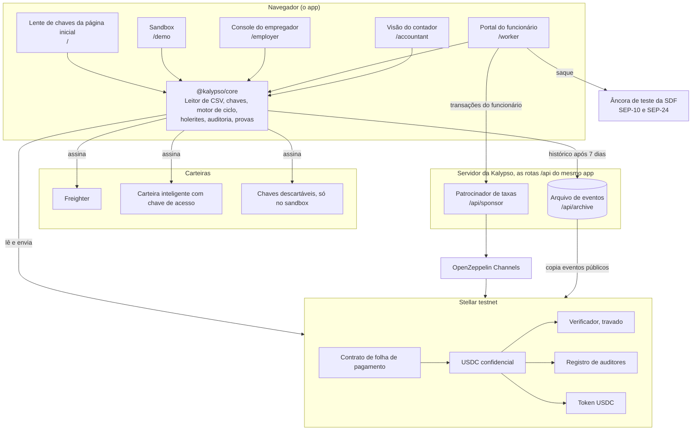
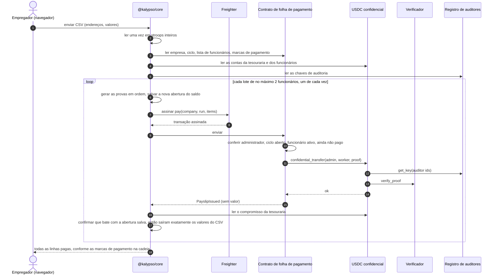
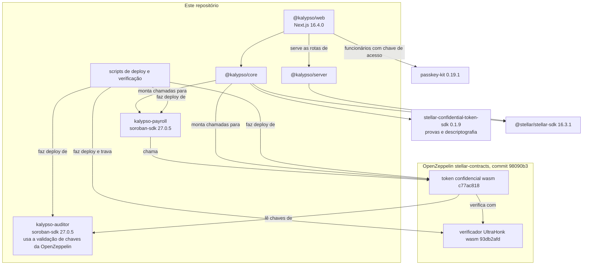

A Kalypso tem quatro partes: o token confidencial da OpenZeppelin na Stellar, dois contratos nossos (folha de pagamento e um registro de chaves de auditoria), uma biblioteca de cliente que o app web roda no navegador e um servidor com um patrocinador de taxas e um arquivo de eventos, servido pelo mesmo app.

## O sistema inteiro

Os valores existem em forma legível apenas no navegador do empregador (o CSV que ele envia), no navegador do funcionário (os próprios holerites) e no navegador do contador (com a chave dele). O servidor vê os bytes das transações, onde os valores são textos cifrados, e eventos públicos.

Cada caixa no navegador é uma página do app. A lente de chaves da página inicial (`/`) lê a empresa de demonstração com a chave que você escolhe, e o sandbox (`/demo`) roda uma folha de pagamento inteira com chaves descartáveis. O console do empregador (`/employer`) e a visão do contador (`/accountant`) assinam com o Freighter. O portal do funcionário (`/worker`) assina com uma carteira inteligente com chave de acesso ou com o Freighter, envia as chamadas de contrato do funcionário pelo patrocinador de taxas e saca na âncora de teste da SDF. Os [guias](/docs/guides/employer) percorrem cada tela.

## O token confidencial

A Kalypso não inventa a própria criptografia. O dinheiro passa pelo token confidencial da OpenZeppelin para a Stellar (a revisão de 31 de julho de 2026, commit 98090b3 de OpenZeppelin/stellar-contracts), implantado como uma instância própria da Kalypso sobre o USDC de testnet da Circle.

- Você deposita USDC no token e recebe um saldo confidencial. Os valores de depósito são públicos.
- Saldos e valores de transferência são guardados como compromissos de Pedersen (commitments): números selados que o contrato consegue somar e conferir, mas não ler. Quem os detém guarda fora da cadeia a abertura de cada compromisso, isto é, o valor e o fator aleatório de ocultação por trás dele.
- Todo gasto leva uma prova de conhecimento zero gerada por quem envia. Ela mostra que o pagamento é válido e que o remetente tem saldo para ele, sem mostrar o número. Um contrato verificador separado confere cada prova.
- Cada conta se registra sob um id de auditor, uma única vez, sem como mudá-lo depois. Toda transferência pode ser lida por duas chaves de auditor: a do remetente, que vê o valor e o novo saldo do remetente, e a do destinatário, que vê o valor.
- O dinheiro que chega cai em um saldo de recebimento separado e é mesclado antes de ser gasto, então ninguém consegue quebrar uma prova de gasto enviando dinheiro para você.
- Os endereços do remetente e do destinatário são públicos. Os valores de retirada são públicos.

## O que o contrato de folha de pagamento acrescenta

O token consegue mover dinheiro confidencial, mas não sabe nada sobre empresas, listas de funcionários ou períodos de pagamento. O [contrato de folha de pagamento](https://github.com/ramakrishnanhulk20/Kalypso/blob/main/packages/contracts/payroll/src/contract.rs) acrescenta isso, e só move dinheiro chamando o `confidential_transfer` do token a partir da tesouraria da empresa.

- Empresas. `create_company(admin, accountant, auditor_id, label)` cria uma empresa cuja tesouraria é a conta do administrador. O administrador já precisa estar registrado no token com o `auditor_id`, e o registro de auditores precisa dizer que `accountant` é dono desse id, ou a chamada falha com o erro 23.
- Convites. O administrador convida um funcionário e o funcionário aceita com a própria assinatura. Um funcionário precisa já estar registrado no token para aceitar. O administrador pode cancelar um convite não aceito ou remover um funcionário, e o histórico de pagamentos permanece.
- Ciclos. `open_run` abre um período de pagamento com um número esperado de funcionários. Um id de ciclo abre uma única vez por empresa, para sempre, e `close_run` o encerra.
- Pagar no máximo uma vez. `pay(company_id, run_id, items)` recebe um ou dois funcionários, cada um com uma prova. Ele confere a assinatura do administrador, se o ciclo está aberto e se cada funcionário está na lista e ainda não foi pago neste ciclo. Depois chama a transferência do token para cada funcionário e marca cada um como pago. Um funcionário listado duas vezes reverte a chamada inteira. O evento do holerite não traz valor. O limite de dois foi definido a partir de tamanhos de transação medidos.
- Contagens. Cada empresa conta os ciclos que abriu e as trocas de administrador, e `memberships_of(worker)` conta as empresas em que um funcionário já entrou. Um leitor de histórico que recebe menos ciclos ou empresas do que a cadeia conta sabe que algo foi escondido.
- Transferência de papel. O papel de administrador passa em duas etapas. A oferta expira dentro do maior tempo de vida de armazenamento da rede, e o novo administrador precisa estar registrado sob o id de auditor da empresa.

Listas de funcionários, ciclos e marcas de pagamento ficam em armazenamento persistente, e toda escrita os estende para 180 dias. O contrato não tem administrador próprio nem caminho de atualização. O token e o registro dele são definidos pelo construtor e ficam fixos por toda a vida do contrato.

## O registro de auditores

O contrato de auditor de exemplo da OpenZeppelin deixa um gerente definir a chave de cada id de auditor. Quem tivesse esse papel poderia trocar a chave de um contador pela sua e ler todos os salários futuros. O [registro de auditores](https://github.com/ramakrishnanhulk20/Kalypso/blob/main/packages/contracts/auditor/src/contract.rs) da Kalypso não tem gerente nem administrador.

- `register_key(owner, point)` guarda uma chave e devolve o próximo id. O dono, normalmente o contador, assina.
- Só o dono pode fazer `rotate_key`. A titularidade passa em duas etapas, com uma oferta que expira.
- As chaves passam pela validação de chaves da OpenZeppelin, que recusa o ponto de identidade e pontos fora da curva.

Os ids são entregues em ordem, então qualquer pessoa pode ler o próximo id e registrar a própria chave nele primeiro. Uma tesouraria que se registrasse sob um id previsto passaria a criptografar todos os salários para o atacante. A Kalypso nunca prevê um id. A tesouraria se registra sob o id que o registro confirmado do contador devolveu. Antes de a tesouraria assinar, o cliente lê da cadeia o dono e a chave desse id e recusa, a menos que sejam os do contador. E o contrato de folha de pagamento se recusa a criar uma empresa, a menos que o registro diga que o contador indicado é dono do id. O ataque P11 do [relatório do ataque](/docs/security/attack-run) tenta esse front-run na testnet a cada execução.

Os funcionários também registram a própria chave de auditoria, então a cópia do destinatário de cada pagamento só abre para aquele funcionário.

## O que acontece no navegador

A biblioteca de cliente, `@kalypso/core`, faz todas as etapas que precisam de um segredo, então os segredos ficam no dispositivo.

### Chaves

A chave de um usuário do Freighter vem da assinatura, pela carteira, de uma mensagem que cita a Kalypso, o domínio dela, a rede, o token e a conta, e diz para assiná-la só no domínio da Kalypso. A derivação usa duas assinaturas dessa mensagem e recusa, a menos que sejam idênticas byte a byte, então se prova que uma chave é reproduzível antes de qualquer coisa ser registrada nela. Quem usa chave de acesso deriva a chave da saída PRF da chave de acesso, e uma chave de acesso que não devolve saída PRF é recusada, nunca enfraquecida. A mesma saída PRF também gera a chave da conta de saque do funcionário. Os dois caminhos são fixados por vetores de teste. O portal do funcionário oferece os dois, e o console do empregador e a visão do contador usam o Freighter. O caminho da chave de acesso já rodou de ponta a ponta no Chrome com um autenticador virtual que tem suporte a PRF. O suporte a PRF muda entre celulares, notebooks e provedores de chave de acesso, e a Kalypso não foi testada em todos.

### Geração de provas

Toda prova é gerada no navegador com os circuitos publicados do token, usando um salt novo de `crypto.getRandomValues`. Uma nova tentativa depois de uma reversão gera uma prova nova com um salt novo.

### O motor de ciclo

Um ciclo de pagamento, de ponta a ponta:

- A planilha é lida uma vez em stroops inteiros, a menor unidade do USDC (7 casas decimais). O que o empregador aprova, a entrada da prova e a conferência depois do pagamento usam esse mesmo valor lido.
- Antes de qualquer transação, uma verificação prévia confere a empresa, o ciclo, a entrada de cada funcionário na lista e o registro dele no token; confere também que ninguém está ligado à chave de auditor de demonstração publicada e que o saldo verificado da tesouraria cobre o ciclo.
- Cada transação de pagamento leva até dois pagamentos, e só um pagamento por tesouraria fica em andamento de cada vez. Cada lote é provado apenas contra o estado da cadeia depois que o anterior é definitivo.
- Depois que cada pagamento é concluído, o motor lê o novo compromisso da tesouraria e confirma que ele abre com o saldo salvo antes do envio, então saíram exatamente os valores aprovados. Qualquer divergência interrompe o ciclo.
- Os rótulos pago, pendente e falhou vêm das marcas de pagamento do contrato, nunca da resposta de um relayer. Um lote que não pode ser montado, por exemplo depois que um funcionário trocou a chave, marca como falhas só as próprias linhas e o ciclo segue. Se a rede recusar uma transação, o ciclo é interrompido.

### Nunca esquecer um pagamento concluído

Antes de um pagamento ser enviado, o dispositivo salva a nova abertura de saldo que o pagamento vai deixar. Esse registro só é removido depois que uma abertura que abre a cadeia é adotada, ou depois que a transação falhou ou expirou pelo relógio da própria cadeia. Nenhuma resposta do RPC apaga uma abertura salva. Um saldo lido um ledger atrasado, um horário de fechamento falso ou uma segunda aba, portanto, acabam com o ciclo sendo retomado, nunca com uma tesouraria travada. Um ciclo que cai no meio é retomado a partir das marcas de pagamento na cadeia, e ninguém é pago duas vezes.

### A reconstrução

Em um notebook novo, depois de limpar o armazenamento ou quando os registros do dispositivo discordam da cadeia, o empregador pode reconstruir a abertura da tesouraria a partir do histórico de token dela. O resultado precisa abrir o saldo da cadeia, ou nada é gravado. O que o dispositivo esperava aparece ao lado do que a cadeia guarda, porque uma diferença significa que a tesouraria se moveu de um jeito que este dispositivo não registrou. A reconstrução é sempre uma etapa explícita, nunca automática.

### Leitura do pagamento

Um holerite só aparece quando um evento de folha de pagamento do contrato da Kalypso, uma transferência de token da tesouraria da empresa para aquele funcionário na mesma transação e a marca de pagamento na cadeia concordam entre si, e o valor descriptografado está dentro do intervalo. Uma transferência direta ou um depósito de qualquer outra pessoa nunca vira holerite, e os totais do contador contam exatamente o mesmo conjunto. Todo saldo reconstruído a partir do histórico é conferido contra o compromisso na cadeia antes de ser mostrado ou usado, e uma divergência mostra "Histórico incompleto", nunca um número.

## O patrocinador de taxas e o arquivo

O patrocinador de taxas (`POST /api/sponsor`) paga a taxa de rede das transações do próprio funcionário e as repassa pelo OpenZeppelin Channels. Para um funcionário com chave de acesso, ele cuida da entrada inteira: criar a carteira com chave de acesso, registrar a chave de auditoria do próprio funcionário, registrar no token e aceitar o convite. Ele também paga a mesclagem e a retirada que movem o pagamento para a conta de saque. Um funcionário com Freighter assina a própria transação, e o patrocinador a envolve em um fee bump. O console do empregador e a visão do contador não o usam: essas carteiras pagam as próprias taxas.

Ele não é um relay aberto. Ele decodifica os bytes exatos que vai repassar e só paga por uma host function cuja raiz seja uma de três coisas: uma chamada ao contrato de folha de pagamento ou ao token da Kalypso, `register_key` no registro de auditores da Kalypso assinado apenas pelo dono da chave, ou a criação de uma carteira com chave de acesso. Essa criação precisa vir do deployer compartilhado do passkey-kit, rodar o código de carteira fixado e definir exatamente um signatário de chave de acesso, sem expiração e sem limites, e só pode tocar nas entradas da própria carteira nova. Todo contrato que a chamada pode executar precisa ser da Kalypso, do USDC, o verificador ou uma carteira que rode o código fixado, e a taxa precisa ser menor que 2.5 XLM na testnet. Os limites valem por IP por hora, por endereço que autoriza a chamada por dia, para no máximo três criações de carteira por IP por dia e para um orçamento diário de 200 XLM na testnet. Um relay que o relayer recusou comprovadamente devolve o seu orçamento, e uma aprovação assinada é repassada no máximo uma vez. O patrocinador nunca paga por operações comuns da Stellar, então uma conta de saque paga as próprias taxas pequenas em XLM pela trustline de USDC e pelo pagamento da âncora.

O RPC da Stellar guarda os eventos de mais ou menos os últimos 7 dias, e um saldo confidencial não pode ser lido nem gasto sem o seu histórico. O arquivo de eventos copia literalmente os eventos públicos dos contratos da Kalypso, num cronograma que não depende de visitantes, e os deduplica pelo id do evento. Ele registra quais ledgers possui, sem lacunas. Toda resposta diz se está completa e até onde ele ingeriu, e a verificação de saúde dele responde 503 diante de uma lacuna ou de uma ingestão atrasada. Ele só garante o histórico desde o deploy quando os primeiros eventos de token que leu vêm da própria transação de deploy do token; caso contrário, a saúde dele diz a partir de qual ledger ele garante. A API dele fica em `/api/archive/v1/...` no próprio servidor do app e é compatível com os clientes de indexador do SDK confidencial.

Toda tela lê o arquivo do próprio site em `/api/archive`, e só por https. Quando o arquivo não responde, ou a página roda num servidor de desenvolvimento http simples, os leitores usam apenas a janela do RPC, então o histórico com mais de cerca de 7 dias aparece como incompleto em vez de aparecer como um número.

Nada confia só no arquivo. Um saldo reconstruído a partir dele precisa abrir o compromisso na cadeia, e uma lista de holerites precisa bater com as contagens da própria cadeia. Ele está no ar, e a saúde dele é pública em https://kalypso-payroll.vercel.app/api/archive/v1/health.

## O que depende do quê

Os dois contratos fixam o soroban-sdk 27.0.5 para combinar com o token da OpenZeppelin implantado. Todo endereço, hash de código e chamada está em [Contratos e endereços](/docs/contracts).
