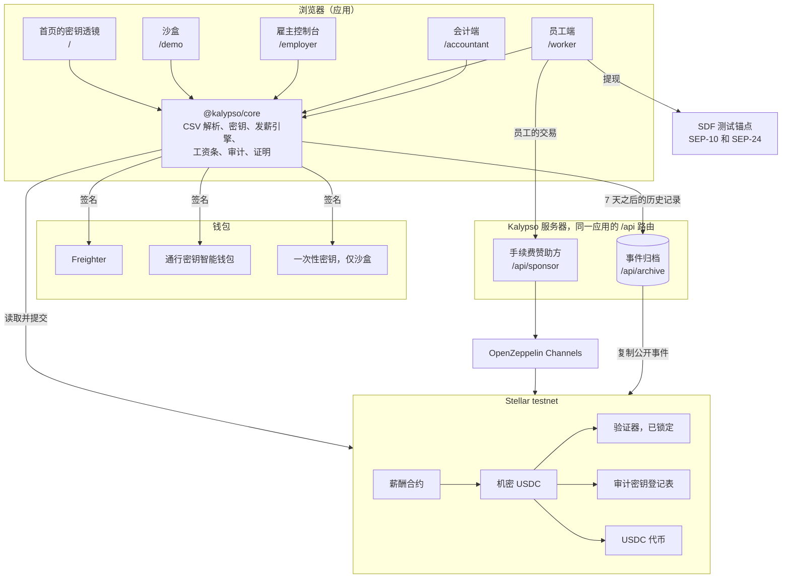
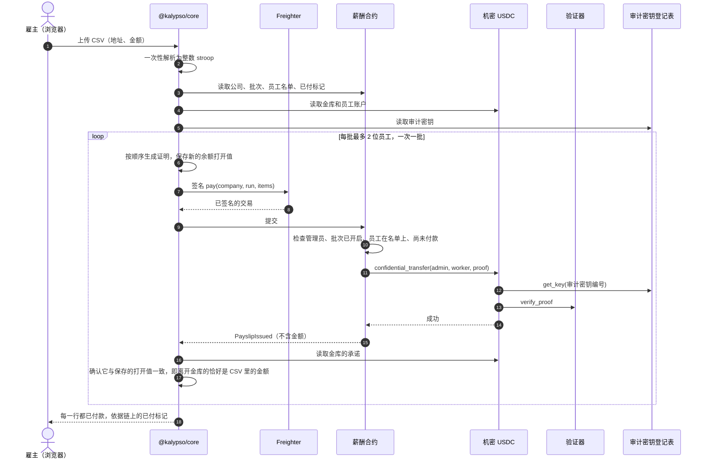
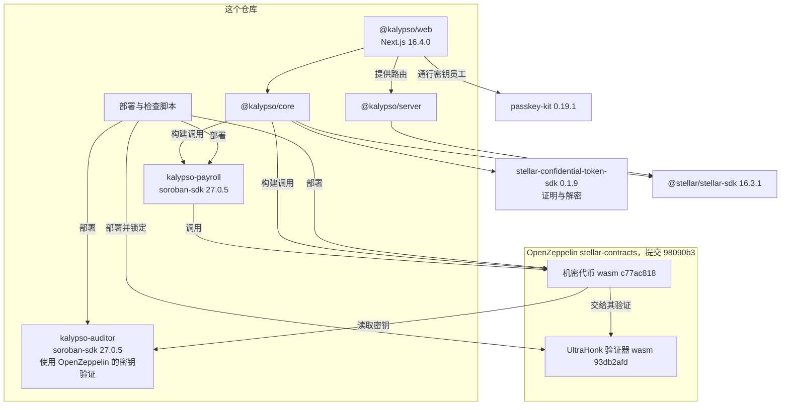

Kalypso 有四个部分：Stellar 上 OpenZeppelin 的机密代币，我们自己的两份合约（薪酬合约和审计密钥登记表），网页应用在浏览器里运行的客户端库，以及一个带手续费赞助方和事件归档的服务器，由同一个应用提供。

## 整个系统

金额只会以明文形式出现在雇主的浏览器（他们上传的 CSV）、员工的浏览器（他们自己的工资条）和会计的浏览器（凭他们的密钥）里。服务器看到的是交易字节，其中的金额是密文，以及公开事件。

浏览器里的每个方框都是应用的一个页面。首页的密钥透镜（`/`）用你选的密钥读取示例公司，沙盒（`/demo`）用一次性密钥跑完整个薪酬流程。雇主控制台（`/employer`）和会计端（`/accountant`）用 Freighter 签名。员工端（`/worker`）用通行密钥智能钱包或 Freighter 签名，通过手续费赞助方发送员工的合约调用，并在 SDF 测试锚点提现。[各指南](/docs/guides/employer)逐个讲解这些界面。

## 机密代币

Kalypso 不自己发明密码学。资金通过 OpenZeppelin 为 Stellar 做的机密代币流动（2026 年 7 月 31 日的版本，OpenZeppelin/stellar-contracts 的提交 98090b3），部署为 Kalypso 自己的实例，建在 Circle 的 testnet USDC 之上。

- 你把 USDC 存入代币，得到一份机密余额。存入的金额是公开的。
- 余额和转账金额以 Pedersen 承诺的形式存储：已密封的数字，合约可以把它们相加、核对，却读不出来。持有者在链下保存每个承诺背后的打开值（opening）、数值和随机盲化因子。
- 每次支出都带有发送方生成的零知识证明。它证明这笔付款有效且发送方付得起，而不显示数字。一份独立的验证器合约检查每个证明。
- 每个账户只在一个审计密钥编号下登记一次，之后无法更改。每笔转账都能被两把审计密钥读取：发送方的那把，能看到金额和发送方的新余额；接收方的那把，能看到金额。
- 进账的钱落在一个独立的接收余额里，花之前要先合并，所以没有人能通过给你转钱来破坏你的支出证明。
- 发送方和接收方的地址是公开的。转出的金额是公开的。

## 薪酬合约增加了什么

代币能转移机密资金，但它对公司、员工名单或发薪周期一无所知。[薪酬合约](https://github.com/ramakrishnanhulk20/Kalypso/blob/main/packages/contracts/payroll/src/contract.rs)补上了这些，而且它转移资金的唯一方式，是从公司金库中调用代币的 `confidential_transfer`。

- 公司。`create_company(admin, accountant, auditor_id, label)` 创建一家公司，其金库就是管理员的账户。管理员必须已在 `auditor_id` 下登记到代币，并且审计密钥登记表必须确认 `accountant` 拥有该编号，否则调用会以错误 23 失败。
- 邀请。管理员邀请员工，员工用自己的签名接受。员工必须已登记到代币才能接受。管理员可以撤回尚未被接受的邀请，或移除员工，付款历史会保留。
- 批次。`open_run` 开启一个发薪周期，并指定预期人数。同一家公司的批次编号只能开启一次，永远如此，`close_run` 将其结束。
- 至多付一次。`pay(company_id, run_id, items)` 接受一到两位员工，每人附一份证明。它检查管理员的签名、批次已开启，以及每位员工都在名单上且在本批次尚未付款。然后对每位员工调用代币的转账，并把每人标记为已付。同一位员工列了两次，整个调用就会回滚。工资条事件不含金额。两位的上限是根据实测的交易大小定的。
- 计数器。每家公司记录它开启的批次数和管理员的变更次数，`memberships_of(worker)` 统计员工加入过的公司数。历史读取方如果拿到的批次或公司比链上计数的少，就知道有内容被藏起来了。
- 移交。管理员角色分两步移交。邀约会在网络最长存储期限内过期，接任的管理员必须已在该公司的审计密钥编号下登记。

名单、批次和已付标记存放在持久存储里，每次写入都把它们延长到 180 天。合约自己没有管理员，也没有升级路径。它的代币和登记表由构造函数设定，在合约的整个生命周期里固定不变。

## 审计密钥登记表

OpenZeppelin 的示例审计合约让一位管理者可以设置每个审计密钥编号下的密钥。谁持有这个角色，谁就能把会计的密钥换成自己的，并读到以后的每一份薪水。Kalypso 的[审计密钥登记表](https://github.com/ramakrishnanhulk20/Kalypso/blob/main/packages/contracts/auditor/src/contract.rs)没有管理者，也没有管理员。

- `register_key(owner, point)` 存下一把密钥并返回下一个编号。由所有者（通常是会计）签名。
- 只有所有者能 `rotate_key`。所有权分两步转移，邀约会过期。
- 密钥要经过 OpenZeppelin 的密钥验证，它会拒绝单位元（identity point）和不在曲线上的点。

编号是按顺序发放的，所以任何人都能读到下一个编号，并抢先用自己的密钥登记。若金库在一个预测出来的编号下登记，就会把每一份薪水加密给攻击者。Kalypso 从不预测编号。金库在会计已确认的登记所返回的编号下登记。金库签名之前，客户端会从链上读取该编号的所有者和密钥，除非它们是会计的，否则拒绝。并且薪酬合约会拒绝创建公司，除非登记表确认所指定的会计拥有该编号。[攻击测试](/docs/security/attack-run)里的攻击 P11 每次运行都在 testnet 上尝试这种抢先登记。

员工也登记自己的审计密钥，所以每笔付款中接收方的那份副本只有那位员工能打开。

## 浏览器里发生了什么

客户端库 `@kalypso/core` 完成每一个需要秘密的步骤，所以秘密留在设备上。

### 密钥

Freighter 用户的密钥来自钱包对一条消息的签名；这条消息写明 Kalypso、它的域名、网络、代币和账户，并说明只能在 Kalypso 的域名上签名。推导需要对这条消息签两次，并且只有两次签名逐字节相同才会继续，所以在任何内容用它登记之前，这把密钥就已被证明可重现。通行密钥用户则改用通行密钥的 PRF 输出来推导密钥，如果通行密钥没有返回 PRF 输出，就拒绝，绝不降低要求。同一个 PRF 输出也生成员工提现账户的密钥。两条路径都有测试向量固定。员工端两种都提供，雇主控制台和会计端使用 Freighter。通行密钥这条路径已在 Chrome 中用支持 PRF 的虚拟认证器端到端跑通。PRF 的支持在手机、笔记本电脑和通行密钥提供方之间各不相同，Kalypso 没有在每一种上检查过。

### 证明

每个证明都在浏览器里用代币公布的电路生成，使用来自 `crypto.getRandomValues` 的新盐值。回滚之后的重试会用新盐值生成新证明。

### 发薪引擎

一次发薪批次，从头到尾：

- 电子表格只解析一次，解析为整数 stroop，也就是 USDC 的最小单位（7 位小数）。雇主批准的内容、证明的输入，以及付款之后的检查，用的都是这同一个解析出来的值。
- 发送任何交易之前，预检会检查公司、批次、每位员工的名单条目和代币登记，检查没有人绑定在已公布的演示审计密钥上，并检查金库已验证的余额够付这个批次。
- 每笔付款交易最多带两笔付款，每个金库同一时间只有一笔付款在途。每一批都只针对上一批最终确认之后的链上状态生成证明。
- 每笔付款上链之后，引擎会读取金库的新承诺，并确认它能用发送之前保存的余额打开，所以离开金库的恰好是获批的金额。任何不一致都会让批次停下。
- 已付、待处理和失败的标签来自合约的已付标记，绝不来自中继服务的回复。无法生成的一批（例如员工轮换了密钥之后）只会把它自己的几行标为失败，批次继续。网络的拒绝会让批次停止。

### 绝不忘记已上链的付款

发送一笔付款之前，设备会保存这笔付款将留下的新余额打开值。只有在采用了能打开链上承诺的打开值之后，或者按链自己的时钟这笔交易已失败或过期之后，这条记录才会被删除。任何 RPC 的回答都不会删除已保存的打开值。所以，读到落后一个账本的余额、一个说谎的关闭时间，或者第二个标签页，结果都是批次继续，而不会锁死金库。中途崩溃的批次会根据链上的已付标记继续，没有人会被重复付款。

### 重建

在新电脑上、清除存储之后，或者设备的记录与链上不一致时，雇主可以根据金库的代币历史重建金库的打开值。结果必须能打开链上的余额，否则什么都不写入。设备原本预期的值会与链上的值并排显示，因为两者不同意味着金库发生了这台设备没有记录的变动。重建永远是一个明确的步骤，从不自动进行。

### 读取薪水

一张工资条只有在这三者一致时才会显示：Kalypso 合约发出的薪酬事件、同一笔交易里从公司金库到该员工的一笔代币转账，以及链上的已付标记，并且解密出的金额在范围内。别人直接转来的款或存款不会成为工资条，会计的合计统计的也是完全相同的一组。从历史重建的每个余额，在显示或使用之前都会对照链上的承诺检查，不一致时显示“历史记录不完整”，绝不显示一个数字。

## 手续费赞助方与归档

手续费赞助方（`POST /api/sponsor`）为员工自己的交易支付网络手续费，并通过 OpenZeppelin Channels 转发。对通行密钥员工，它负责整个加入流程：创建通行密钥钱包、登记员工自己的审计密钥、登记到代币，以及接受邀请。它也为把薪水转到提现账户的合并和转出付费。Freighter 员工自己签交易，赞助方再把它包进一笔 fee bump（代付手续费）交易里。雇主控制台和会计端不使用它：那些钱包自己付手续费。

它不是开放的中继。它会解码即将转发的确切字节，只为一个宿主函数付费，且其根必须是下列三种之一：调用 Kalypso 的薪酬合约或代币，由密钥所有者单独签名的、对 Kalypso 审计密钥登记表的 `register_key`，或者一次通行密钥钱包的创建。这次创建必须来自 passkey-kit 的共享部署者，运行固定的钱包代码，且恰好设置一个没有过期时间也没有限额的通行密钥签名者，并且只能触及它自己新钱包的条目。这次调用可能运行的每一份合约都必须是 Kalypso 的、USDC 的、验证器的，或运行固定代码的钱包，且手续费在 testnet 上必须低于 2.5 XLM。限额按每个 IP 每小时、每个授权地址每天、每个 IP 每天最多三次钱包创建，以及 testnet 上每天 200 XLM 的预算来计算。中继服务明确拒绝的转发会归还它的预算，一份已签名的批准最多只被转发一次。赞助方从不为普通的 Stellar 操作付费，所以提现账户要自己支付它的 USDC trustline 和锚点付款所需的少量 XLM 手续费。

Stellar RPC 大约只保留最近 7 天的事件，而机密余额没有历史就无法读取或花费。事件归档原样复制 Kalypso 合约的公开事件，按一个不依赖访客的时间表运行，并按事件编号去重。它记录自己持有哪些账本，没有缺口。每个回复都会说明自己是否完整，以及已经摄取到哪里，遇到缺口或摄取过时，它的健康检查会回答 503。只有当它读到的第一批代币事件来自代币自己的部署交易时，它才为部署以来的历史担保；否则它的健康检查会说明它从哪个账本开始担保。它的 API 位于应用自己服务器上的 `/api/archive/v1/...`，与机密 SDK 的索引器客户端兼容。

每个界面都从自己站点的 `/api/archive` 读取归档，而且只走 https。当归档没有回应，或页面运行在普通 http 开发服务器上时，读取方只用 RPC 的窗口，所以大约 7 天以前的历史会显示为不完整，而不是显示为一个数字。

没有任何东西只信任归档。用它重建的余额必须能打开链上的承诺，工资条列表必须与链自己的计数器一致。它已上线，它的健康状况公开在 https://kalypso-payroll.vercel.app/api/archive/v1/health。

## 谁依赖谁

两份合约固定使用 soroban-sdk 27.0.5，以匹配已部署的 OpenZeppelin 代币。每个地址、代码哈希和调用都在[合约与地址](/docs/contracts)。
